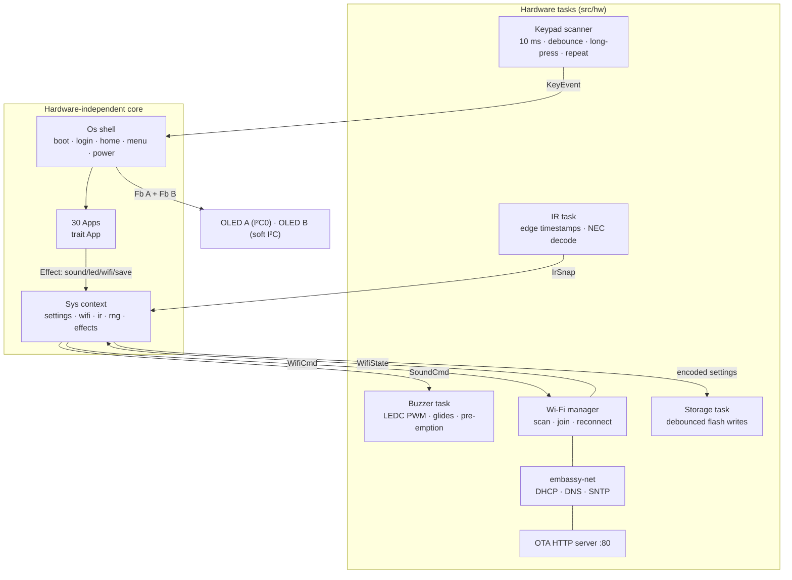
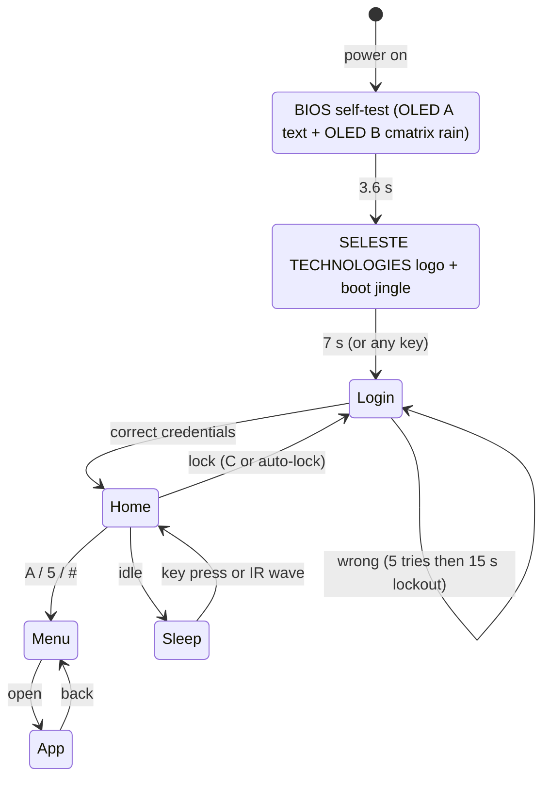
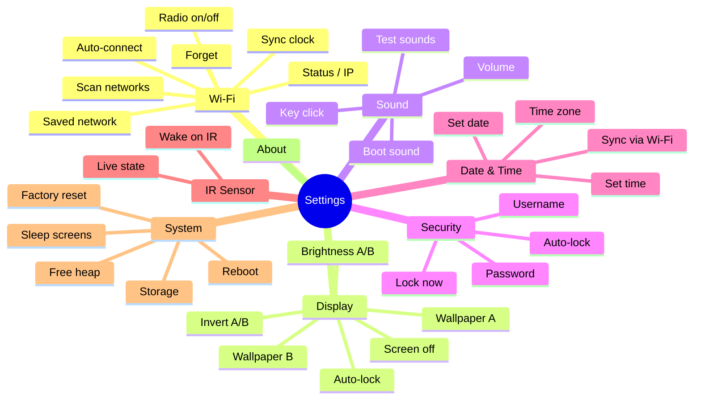

<div align="center">

# ✦ AETHERIS OS ✦

### A phone-style operating environment for the **ESP32-C6**, written in **Rust**
**Dual-OLED shell · multi-tap keypad login · 33 apps · piano with chords · Wi-Fi · OTA updates**

*Powered by **Seleste Technologies***


</div>

---

## 🧱 Tech stack

```text
┌──────────────────────────────────────────────────────────────────────────────┐
│  APPS            33 apps · Piano · Settings · Wi-Fi · Games · IR lab · OTA   │
├──────────────────────────────────────────────────────────────────────────────┤
│  SHELL (os.rs)   Boot · Login · Home · App grid · Lock · Sleep · Wallpapers  │
├──────────────────────────────────────────────────────────────────────────────┤
│  UI TOOLKIT      Fb 128×64 framebuffer · embedded-graphics fonts · icons     │
│                  multi-tap text entry · phone-style keypad legend            │
├──────────────────────────────────────────────────────────────────────────────┤
│  SERVICES        Buzzer sound engine · IR/NEC decoder · Settings (CRC+SHA)   │
│                  Wi-Fi manager · DHCP · SNTP · OTA + slave flash HTTP        │
├──────────────────────────────────────────────────────────────────────────────┤
│  RUNTIME         Rust 2024 · #![no_std] + alloc · Embassy async executor     │
│                  esp-rtos · esp-hal 1.2 · esp-radio · embassy-net/smoltcp    │
├──────────────────────────────────────────────────────────────────────────────┤
│  HARDWARE        ESP32-C6 (R8N16, 16 MB flash) · 2× SSD1306 OLED · 4×4 keypad│
│                  IR sensor · passive buzzer · green status LED               │
└──────────────────────────────────────────────────────────────────────────────┘
```

| Block | Technology | Used for |
|---|---|---|
| 🦀 Language | **Rust 2024**, `#![no_std]`, `alloc` | all firmware |
| ⚙️ HAL | **esp-hal 1.2** | GPIO, I²C, LEDC (PWM), RNG, reset |
| 🧵 Scheduler | **esp-rtos** + **Embassy** | async tasks, timers |
| 📡 Radio | **esp-radio** (Wi-Fi 6, 2.4 GHz) | scan, join, auto-reconnect |
| 🌐 Network | **embassy-net** (smoltcp) | DHCP, DNS, UDP (SNTP), TCP OTA / slave programmer |
| 🖥 Graphics | **embedded-graphics** + own SSD1306/SH1106 driver | two OLED panels |
| 💾 Storage | **esp-storage** + **esp-bootloader-esp-idf** | settings, partitions, OTA slots |
| 🔐 Security | **sha2** (salted SHA-256) | login password hash |
| 🔊 Audio | LEDC PWM square wave | boot jingle, alerts, piano, music |

> **Honest scope:** Aetheris is a firmware *shell* — it runs on the Espressif ROM + bootloader and a Rust runtime.
> It is not a standalone desktop-class OS, but it boots, logs you in, launches apps, stores settings, joins Wi-Fi and updates itself over the air like one.

---

## ✨ Features

- **Boots like a computer** – BIOS-style self-test lines on the main OLED while **cmatrix digital rain** falls on the second one, then the **SELESTE TECHNOLOGIES** splash with a boot jingle.
- **Login screen** – username + password typed on the keypad **like an old button phone** (multi-tap: `2` = a b c 2 …). Phone keypad legend is shown live on the second OLED. 5 wrong attempts → 15 s lockout.
- **Home screen** – clock, date, Wi-Fi & volume icons, per-screen **animated wallpapers** (9 to choose from, one per OLED), quick-launch dock.
- **App grid** – icons of every app drawn on the second OLED (4×2 per page), name/description on the main one.
- **Settings like a small phone** – Wi-Fi (scan, join, forget, auto-connect), display (wallpapers, brightness, invert, screen-off, auto-lock), sound (volume, key click, boot sound), security (username/password), date & time, IR, system (reboot, sleep, factory reset).
- **Wi-Fi** – scans and lists networks with signal; password typed on the keypad. When connected the **green LED lights** and a **Wi-Fi icon** appears. Clock syncs by SNTP.
- **IR sensor** – wakes the screen with a wave, counts objects, measures RPM, decodes NEC remote codes.
- **Buzzer voices** – boot jingle, accept, error, back, notify, alarm, lock/unlock, connect/disconnect, shutdown… all with adjustable volume.
- **Piano** – every semitone (sharps/flats) with real frequencies, octave shift, and a **chord mode** (maj, min, 7, maj7, m7, dim, aug, sus2, sus4, 6, m6, add9).
- **OTA + slave programmer** – self-update into the inactive slot with rollback protection, or stage an app image and flash an ESP32-C3/S3/C6 slave over controlled UART boot mode.
- **Persistent** – settings and notes survive reboots (CRC-protected flash partition).

---

## 🔌 Hardware

| # | Part | Notes |
|---|---|---|
| 1 | **ESP32-C6** dev board, R8N16 module (16 MB flash) | 3.3 V logic |
| 2 | **OLED A** – 0.96″ 128×64, yellow + blue, I²C (`GND VDD SCK SDA`) | main screen: top 16 px (yellow) = title bar |
| 3 | **OLED B** – 0.96″ 128×64, blue, I²C (`GND VDD SCK SDA`) | second screen: visuals, icons, wallpapers |
| 4 | **4×4 membrane keypad** (`1-9 0 * #  A B C D`, 8 pins) | 4 rows + 4 columns |
| 5 | **IR sensor** (`OUT GND VCC`) | obstacle/proximity module *or* TSOP-style receiver |
| 6 | **Passive buzzer** (`GND I/O VCC`) | driven with PWM |
| 7 | **Green LED** + resistor (220 Ω – 1 kΩ) | Wi-Fi status |
| 8 | Optional **ESP32-C3/S3/C6 slave** | 3.3 V UART; power separately |

## 🔧 Wiring (all connections)

### Pin map

| Component | Pin on component | ESP32-C6 | Note |
|---|---|---|---|
| **OLED A** (yellow/blue) | SDA | **GPIO6** | hardware I²C0 |
| | SCK / SCL | **GPIO7** | hardware I²C0 |
| | VDD | **3V3** | |
| | GND | **GND** | |
| **OLED B** (blue) | SDA | **GPIO20** | own bus (bit-banged) |
| | SCK / SCL | **GPIO21** | own bus (bit-banged) |
| | VDD | **3V3** | |
| | GND | **GND** | |
| **Keypad** rows | R1 / R2 / R3 / R4 | **GPIO0 / GPIO1 / GPIO2 / GPIO3** | driven low one at a time |
| **Keypad** columns | C1 / C2 / C3 / C4 | **GPIO10 / GPIO11 / GPIO18 / GPIO19** | inputs with pull-up |
| **IR sensor** | OUT | **GPIO4** | active-low |
| | VCC | **3V3** | |
| | GND | **GND** | |
| **Green LED** | anode → resistor → | **GPIO22** | |
| | cathode | **GND** | |
| **Passive buzzer** | I/O | **GPIO23** | PWM tone |
| | VCC (VSS) | **3V3** | |
| | GND | **GND** | |
| **Slave programmer** | UART TX → target UART0 RX | **GPIO8** | ESP32-C6 UART1, 115200 baud |
| | UART RX ← target UART0 TX | **GPIO9** | cross TX/RX |
| | BOOT control → target BOOT strap | **GPIO5** | active low |
| | RESET control → target EN/RESET | **GPIO15** | active low |
| | Ground | **GND** | common ground; power slave separately |

> **Why two separate I²C buses?** Both panels normally share the address `0x3C`, so they cannot sit on one bus.
> Giving OLED B its own pins means **no address jumpers or multiplexer are needed** and each screen is fully independent.
>
> The programmer uses GPIO5, 8, 9 and 15 when a slave is attached. GPIO8/9 on the host are strap pins; keep the slave UART high-impedance while Aetheris resets. GPIO15 is a host strapping pin, so the target EN pull-up must leave it high while Aetheris resets.

### Slave target UART0 pins

| Slave chip | Target RX (connect from Aetheris GPIO8 TX) | Target TX (connect to Aetheris GPIO9 RX) | BOOT strap |
|---|---:|---:|---:|
| ESP32-C3 dev board with UART labels | RX | TX | GPIO9 / BOOT |
| ESP32-S3 | GPIO44 | GPIO43 | GPIO0 |
| ESP32-C6 | GPIO17 | GPIO16 | GPIO9 |

For a C3 dev board, use its printed **RX** and **TX** pins (these are the UART0 connections; GPIO20/21 are not exposed on every board). Connect Aetheris GPIO5 to target GPIO9/BOOT, GPIO15 to EN, and both grounds. Power the target independently; only share 5V if the source and both boards' power arrangements are understood. Never connect both 5V sources together or connect the 3V3 rails.

### Wiring diagram

```mermaid
flowchart LR
    subgraph MCU["ESP32-C6 DevKit (R8N16)"]
        G6["GPIO6 (SDA0)"]
        G7["GPIO7 (SCL0)"]
        G20["GPIO20"]
        G21["GPIO21"]
        R["GPIO0 · 1 · 2 · 3"]
        C["GPIO10 · 11 · 18 · 19"]
        G4["GPIO4"]
        G22["GPIO22"]
        G23["GPIO23"]
        V["3V3"]
        GND["GND"]
    end
    OA["OLED A<br/>yellow + blue<br/>SDA · SCK · VDD · GND"]
    OB["OLED B<br/>blue<br/>SDA · SCK · VDD · GND"]
    KP["4x4 keypad<br/>R1-R4 · C1-C4"]
    IR["IR sensor<br/>OUT · VCC · GND"]
    LED["Green LED<br/>+ resistor"]
    BZ["Passive buzzer<br/>I/O · VCC · GND"]
    G6 --- OA
    G7 --- OA
    G20 --- OB
    G21 --- OB
    R --- KP
    C --- KP
    G4 --- IR
    G22 --- LED
    G23 --- BZ
    V -.3.3V.- OA & OB & IR & BZ
    GND -.GND.- OA & OB & IR & LED & BZ
```

### Keypad matrix

The 8-pin membrane connector is normally ordered **R1 R2 R3 R4 C1 C2 C3 C4** (left → right, rows first).

```text
              C1(GPIO10) C2(GPIO11) C3(GPIO18) C4(GPIO19)
R1 (GPIO0)  ┤     1          2          3          A
R2 (GPIO1)  ┤     4          5          6          B
R3 (GPIO2)  ┤     7          8          9          C
R4 (GPIO3)  ┤     *          0          #          D
```

If your membrane is ordered differently, open **Menu → Key Test**: it shows the row/column of every key you press, and
`KEYMAP` in `src/input.rs` (or the pin order in `src/bin/main.rs`) can be adjusted to match.

### Power

Everything runs from the board's **3.3 V** rail and a shared **GND**. Total current is well within USB power
(two OLEDs ≈ 20-40 mA, Wi-Fi bursts ≈ 250 mA peak).

---

## 🏗 Architecture



**Design rule:** apps never touch hardware. They draw into two framebuffers and push *effects* (play sound, pulse LED, save, join Wi-Fi…).
The main loop turns effects into real actions. That keeps the whole UI testable on a PC (see `aetheris-sim`).

### Boot sequence



### Two screens, two jobs

| | **OLED A** (yellow/blue) | **OLED B** (blue) |
|---|---|---|
| Role | main interaction + title bar (yellow strip) | visuals & context |
| Boot | BIOS text → logo | cmatrix rain → logo reveal |
| Login | username / password fields | live phone-keypad legend |
| Home | clock, date, status icons | wallpaper + favourite-app dock |
| Menu | app name + description + page | **icon grid** (4×2) |
| Settings | the list you navigate | preview (wallpapers, volume, Wi-Fi…) |
| Apps | controls and values | graphs, keyboards, visualisers |

---

## ⌨ Keypad

| Key | Menus | Text entry | Anywhere |
|---|---|---|---|
| `2` / `A` | up | – | |
| `8` / `B` | down | – | |
| `4` / `C` | left | – | |
| `6` / `D` | right | – | |
| `5` / `#` | OK | `#` = confirm | |
| `*` | back | `*` = backspace (hold = clear) | **hold `*` = jump to Home** |
| `0-9` | | multi-tap letters | |

**Multi-tap text entry** (login, Wi-Fi password, notes, Morse…): press a key repeatedly within 1 s to cycle its characters.
`A` = abc / ABC / 123 mode · `B` = show/hide password · `C` = clear · `D` = cancel / switch field.

```text
 1 .,?!@-_   2 abc   3 def
 4 ghi       5 jkl   6 mno
 7 pqrs      8 tuv   9 wxyz
 *  del      0 space #  ok
```

**Home shortcuts:** `A`/`5`/`#` apps · `B` settings · `C` lock · `D` Wi-Fi · `1-4` favourite apps (Settings, Piano, Calculator, Snake).

---

## 📱 Apps (30)

| # | App | What it does | Controls |
|---|---|---|---|
| 1 | **Settings** | full phone-style settings tree | arrows · `5` OK · `*` back |
| 2 | **Wi-Fi** | scan networks, signal & channel | `2/8` select · `4/6` rescan |
| 3 | **Piano** | chromatic keyboard + chord mode, live keyboard on OLED B | see below |
| 4 | **Music Box** | 7 public-domain melodies with piano-roll visualiser | `2/8` song · `#` play |
| 5 | **Calculator** | + − × ÷ with decimals and history | `A + B − C × D ÷` · `*` point · `#` = · hold `#` clear |
| 6 | **Clock** | digital time/date + analog face | `#` 12/24 h |
| 7 | **Stopwatch** | laps | `#` start/stop · `A` lap · `B` reset |
| 8 | **Timer** | countdown with alarm | digits `mmss` · `A/B/C` = 1/5/10 min · `#` go |
| 9 | **Notes** | 600-char notepad saved to flash | multi-tap · `#` save · `D` exit |
| 10 | **Snake** | arcade classic, speeds up | arrows · `#` restart |
| 11 | **Pong** | vs CPU | `2/8` paddle · `#` serve |
| 12 | **Simon** | memory game with tones + LED | `1/A 3/D 7/B 9/C` |
| 13 | **Reaction** | reflex timer (ms) | any key |
| 14 | **Dice** | D6 ×1-3, D20, coin, 1-100 (hardware RNG) | `5` roll · `A` mode · `B` count |
| 15 | **Metronome** | 30-240 BPM, time signatures, LED + pendulum | `4/6` ±1 · `2/8` ±5 · `0` signature · `#` start |
| 16 | **Tone Lab** | tone / sweep / siren generator | `4/6` ±10 Hz · `2/8` ±100 Hz · `0` mode · `#` on |
| 17 | **Morse** | type text → buzzer + LED in Morse | `#` send · `B` speed |
| 18 | **IR Monitor** | sensor state, pulse widths, **NEC remote codes** | `#` reset |
| 19 | **IR Counter** | counts objects breaking the beam | `#` reset |
| 20 | **Tachometer** | RPM from IR pulses | `4/6` pulses/rev |
| 21 | **Matrix** | full-screen cmatrix rain on both OLEDs | `2/8` speed · `#` invert |
| 22 | **Life** | Conway's Game of Life | `2468` cursor · `5` toggle · `#` run · `A` random |
| 23 | **Signal** | Wi-Fi RSSI graph + "find the router" Geiger beeper | `#` beeper |
| 24 | **System** | heap, uptime, flash, MAC, FPS, memory graph | `2/8` page |
| 25 | **Key Test** | shows row/col of each key, live matrix | hold `*` exit |
| 26 | **Torch** | both OLEDs white + LED | any key = mode |
| 27 | **OTA / Programmer** | self OTA or ESP32-C3/S3/C6 slave app flashing over UART | `2/8` mode · `4/6` target · `#` server |
| 28 | **Focus** | Pomodoro timer: work / short break / long break every 4th, chime + LED, focus stats | `#` start/pause · `4/6` work ±5 min · `2/8` break ±1 min · `B` skip · `A` restart · `C` reset |
| 29 | **Calendar** | month grid (Mon-first) on OLED B, weekday · day of year · ISO week · days from today | `4/6` day · `2/8` week · `A/B` month · `1/3` year · `C` today |
| 30 | **Converter** | length, mass, temperature, volume, speed, area, data, energy; all units listed on OLED B | digits · `*` point · hold `*` ± · `A` type · `B` from · `C` to · `#` delete (hold = clear) · `D` exit |
| 31 | **Playlist** | queue Music Box tracks (up to 16), play in order, saved across reboot | `A` library/playlist · `#` add or play · `B` add/remove · `C` clear · arrows browse |
| 32 | **Prox Alarm** | IR tripwire: arm, wave/block beam → looping siren + LED | `#` arm/disarm (or silence) · `A` edge/while-near · `B` clear trip count |
| 33 | **Ninja Run** | Chrome-dino style runner: jump cactus obstacles, speed ramps up | `#` / `5` / `2` / up jump · `#` again after fall |

### 🎹 Piano

Notes follow the keypad's reading order, so one octave of **all 12 semitones** is under your fingers:

```text
  1  C     2  C#    3  D
  4  D#    5  E     6  F
  7  F#    8  G     9  G#
  *  A     0  A#    #  B
```

* **Note mode** – hold a key to sustain; `A`/`B` = octave up/down (1-7); the exact frequency is shown (`A4 = 440.00 Hz`).
* **Chord mode** (`C`) – press a root note and the chord is **arpeggiated at 55 ms per note** (a single buzzer cannot play polyphony, so this is how chiptunes do it);
  `A`/`B` pick the chord type: *maj min 7 maj7 m7 dim aug sus2 sus4 6 m6 add9*. OLED B lights the chord tones on the keyboard.
* `D` = exit (the `*` key is a note here).

---

## 🔊 Sounds

| Sound | When | Character |
|---|---|---|
| **Boot jingle** | splash screen | rising glide + C-major arpeggio + sparkle |
| Boot beeps | each BIOS line | short tick |
| Click / typing | key presses | 7-9 ms tick |
| Accept | success | two rising notes |
| Error | wrong password, invalid input | low double buzz |
| Back / Select | navigation | short blips |
| Notify | scan results, boot done | triple chime |
| Alarm | timer done | 3× beep pattern |
| Lock / Unlock | lock screen | down / up arpeggio |
| Connect / Disconnect | Wi-Fi | rising / falling |
| Shutdown | reboot | descending + glide |

Volume 0-5 (Settings → Sound) changes the PWM duty cycle. A passive buzzer cannot play recorded speech; it plays square-wave tones.

---

## ⚙ Settings map



**Wallpapers:** Matrix Rain · Starfield · Waves · Retro Grid · Bubbles · Seleste · Circuit · Radar · Plain · Snowfall · Skyline · Ripple · Checker — chosen **independently for each OLED** with a live preview on the second screen.

---

## 📡 Wi-Fi, time and OTA updates

* **Join a network:** Settings → Wi-Fi → *Scan networks* → pick one → type the password → connected. The credentials are saved and re-used at every boot (*Auto-connect*).
* **Status LED:** solid = connected · fast blink = connecting · slow blink = scanning.
* **Clock:** synced from `pool.ntp.org` right after connecting (time zone default **UTC+3**, change in Settings → Date & Time).
* **Self OTA update:**
  1. Connect to Wi-Fi, open **Menu → OTA Update**, press `#` (the screen shows the IP address).
  2. On your PC:
     ```sh
     cargo build --release
     espflash save-image --chip esp32c6 target/riscv32imac-unknown-none-elf/release/aetheris aetheris.bin
     curl --data-binary @aetheris.bin http://<device-ip>/ota
     ```
     Leave out `--merge` so `save-image` emits the app-only image rather than a full-flash image.
  3. The image is written to the *inactive* slot (`ota_0` ⇄ `ota_1`), validated (ESP32-C6 image header), activated, and the device reboots into it.
     A newly booted image is marked *valid* automatically; if it crashes before that the bootloader can roll back.
  > OTA only works if the first flash used the custom partition table (`partitions.csv`, done automatically by `cargo run`).
  > OTA and programmer endpoints have no password: they are only open while this menu is active — use them on a trusted network.
* **Program a slave:** In **OTA / Programmer**, use `2/8` to choose slave programming, `4/6` to choose C3/S3/C6, then press `#`. Build an app-only image for that chip (not a merged full-flash image) and upload it:
  ```sh
  espflash save-image --chip esp32c3 target.elf slave-app.bin
  curl --data-binary @slave-app.bin http://<device-ip>/program/c3
  ```
  Use `/program/s3` or `/program/c6` for those targets. Do not pass `--merge`: the programmer needs an app-only image. The image is staged in a verified unused host-flash range before the slave is reset into its UART ROM loader. It is flashed at `0x10000`; the slave must use that app partition offset, and its bootloader and partition table are preserved. The server validates the image header, segments, checksum, optional SHA-256, embedded chip ID, and attached target chip before erasing the slave app. Use an app image no larger than 3 MB, not a merged full-flash image. Secure-boot/encrypted targets are not supported. A power loss during slave flashing may require reflashing that slave over USB; Aetheris firmware and settings are not overwritten.
  > A ready-to-upload LED blink test image and ESP32-C6 ↔ ESP32-C3 wiring table are in [`c3-programmer-test/`](../c3-programmer-test/).

---

## 🚀 Build & flash

```sh
# one-time: toolchain (rust-toolchain.toml selects nightly + rust-src automatically)
cargo install espflash

cargo build --release          # compile
cargo run --release            # flash over USB with partitions.csv + open serial monitor
```

Put the board in download mode (hold **BOOT**, tap **RESET**) if the port is not detected.
Logs: `ESP_LOG=info` (set in `.cargo/config.toml`).

### First login

| Username | Password |
|---|---|
| `admin` | `1234` |

The login screen shows this hint **only while the default login is still active**. Change both in **Settings → Security**.
Passwords are stored as **salted SHA-256**; the saved Wi-Fi password must be stored in clear text (the radio needs it).

### Memory & flash budget

| | Used |
|---|---|
| Firmware image | ≈ 0.9 MB (slots are 3 MB each) |
| Heap | 150 KB reserved (Wi-Fi ≈ 55 KB) |
| Flash layout | `nvs 24K · otadata 8K · phy 4K · storage 64K · ota_0 3M · ota_1 3M` |

---

## 🗂 Project structure

```text
aetheris/
├── Cargo.toml · rust-toolchain.toml · build.rs · partitions.csv
├── .cargo/config.toml          target, runner (espflash + partition table), build-std
├── wokwi.toml · diagram.json   Wokwi simulation of the wiring above
├── CODEX.md                    notes for AI/code assistants working on this repo
└── src/
    ├── bin/main.rs             hardware init, task spawning, main UI loop
    ├── lib.rs
    ├── os.rs                   shell: boot · login · home · menu · power
    ├── sys.rs · settings.rs    shared context · persistent settings (CRC + SHA-256)
    ├── input.rs                keys, debounce, long-press, multi-tap text entry
    ├── fb.rs · gfx.rs · icons.rs · wallpaper.rs · trig.rs     drawing
    ├── sound.rs · notes.rs · tunes.rs · ir_decode.rs · clock.rs
    ├── apps/                   mod.rs (registry) · settings · tools · music · games · ir · net · widgets
    └── hw/                     oled · soft_i2c · keypad · buzzer · ir · storage · net · shared
```

### Adding your own app

1. Create a struct that implements `App` (`key`, `tick`, `draw`) in `src/apps/`.
2. Add one line to the `apps! { … }` table in `src/apps/mod.rs` (name, description, icon number, constructor).
3. Add an icon `N` in `src/icons.rs` (24×24, drawn with lines/circles/rects).
4. Request sound/LED/Wi-Fi/save through `sys.snd()`, `sys.led_pulse()`, `sys.wifi_cmd()`, `sys.save()`.

---

## 🧪 PC simulator

The hardware-independent half of the OS (shell, apps, UI, settings codec, NEC decoder…) can be run and unit-tested on a PC.
It lives in the separate `aetheris-sim` folder (next to this project) so the ESP target config does not interfere.

---

## 🩺 Troubleshooting

| Symptom | Fix |
|---|---|
| A screen stays black | check SDA/SCK order and `3V3`/`GND`; `OLED …: false` in the serial log means no ACK. Address is `0x3C` (`OLED_ADDR` in `main.rs`; some modules use `0x3D`) |
| Image garbled / shifted 2 px | your panel is a 1.3″ **SH1106** → set `OLED_A_SH1106` / `OLED_B_SH1106 = true` |
| Screen upside down | set `OLED_A_FLIP` / `OLED_B_FLIP = true` |
| Wrong keys | open **Key Test**, compare with the matrix table, adjust `KEYMAP` / pin order |
| Buzzer too quiet | Settings → Sound → Volume 5; a 3-pin module with transistor is louder than a bare piezo |
| IR counts nothing | an obstacle module needs its onboard pot adjusted; a TSOP receiver only reacts to 38 kHz remotes |
| Wi-Fi won't join | 2.4 GHz only; WPA2 networks; password length 8-63 |
| `curl` OTA says "not an ESP32-C6 image" | use `espflash save-image --chip esp32c6 …`, not the raw ELF |

---

<div align="center">

**Aetheris OS** · built with 🦀 Rust · **Seleste Technologies**

</div>
